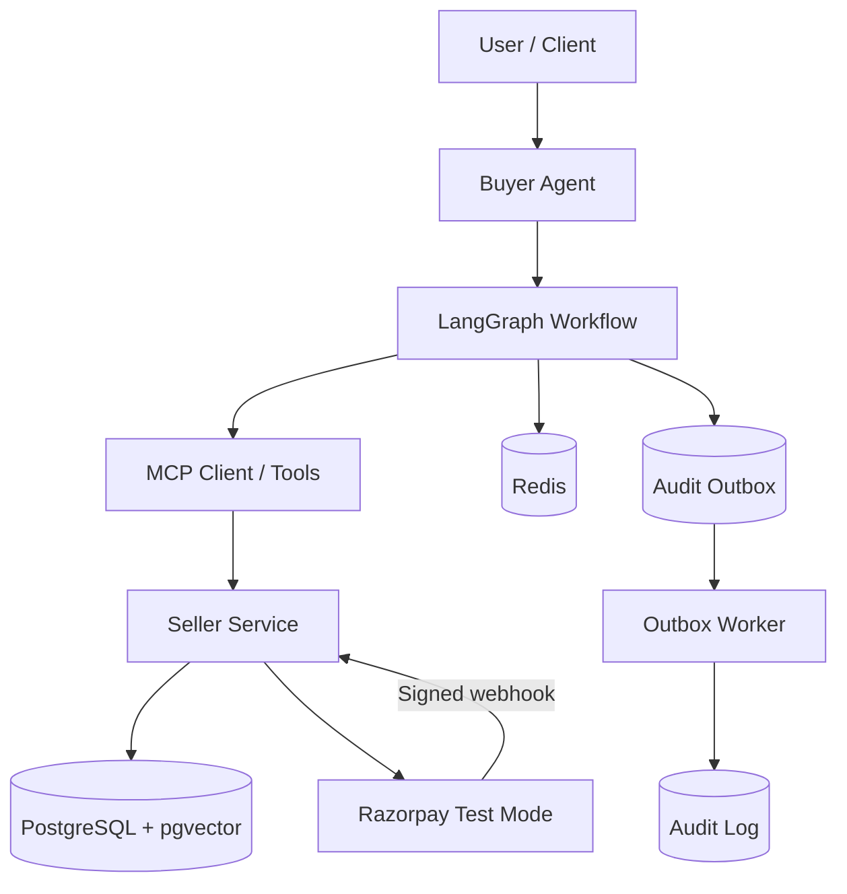
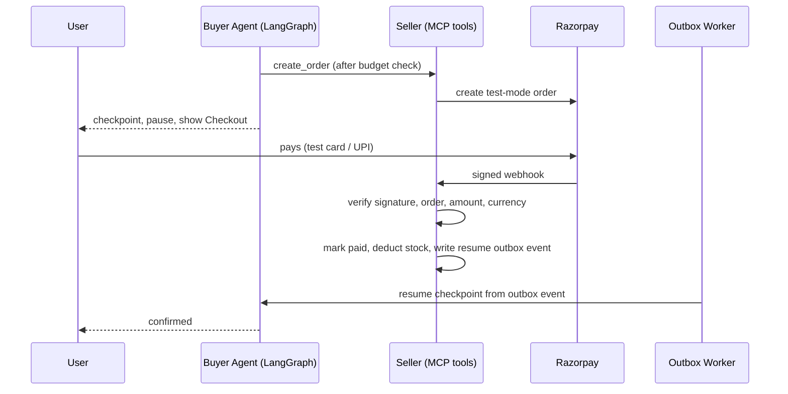

# ShopAgent

**An agentic commerce system that helps users discover, compare, and
purchase products through a conversational shopping workflow.**


[](https://github.com/kanishqdhangar/shopagent-mcp/actions/workflows/tests.yml)

## Demo

<!-- TODO: add demo video link -->
<!-- TODO: add screenshot or GIF of a full run -->
<!-- TODO: add one real audit-log row (node, decision, reasoning, tokens_used, latency_ms) -->

ShopAgent is a multi-service application built around an AI-powered
buyer agent, seller-side product and commerce tools, PostgreSQL with
`pgvector`, Redis, and asynchronous background processing.

The project focuses not only on product discovery, but also on safe
purchasing: explicit user approval for alternative products,
deterministic budget checks, payment-status confirmation, persistent
workflow state, and reliable audit-event delivery.

> **Project status**
>
> Implemented: seller catalog and MCP tools; buyer search, comparison,
> budget checks, and conversational bargaining; alternative-product
> approval; Razorpay order creation and signed webhook verification;
> Redis-backed LangGraph checkpoints; payment reconciliation; and a
> PostgreSQL audit/resume outbox with a retrying worker. The React app
> provides assistant chat, discovery, and checkout status.
>
> Not implemented: an audit-trail/reasoning dashboard, order-history
> page, complementary-product discounts in the upsell node, or a hosted
> deployment configuration. The Compose setup is for local development.
> ShopAgent is not a production-hardened commerce platform.

------------------------------------------------------------------------

## Table of contents

-   [Highlights](#highlights)
-   [Architecture](#architecture)
-   [Shopping workflow](#shopping-workflow)
-   [Conversational negotiation](#conversational-negotiation)
-   [Standalone MCP client](#standalone-mcp-client)
-   [Technology stack](#technology-stack)
-   [Reliability and safety](#reliability-and-safety)
-   [Repository structure](#repository-structure)
-   [Getting started](#getting-started)
-   [Running the tests](#running-the-tests)
-   [Example scenarios](#example-scenarios)
-   [Configuration and secrets](#configuration-and-secrets)
-   [Current scope and limitations](#current-scope-and-limitations)

------------------------------------------------------------------------

## Highlights

-   **Conversational shopping agent:** Interprets shopping requests and
    coordinates product retrieval, comparison, and purchase workflows.
-   **Conversational bargaining:** Lets shoppers request percentage or
    target-price offers, counteroffer, accept, reject, or cancel within
    the seller's configured discount limit.
-   **Agent orchestration:** Uses LangGraph to model the buyer-agent
    workflow and its conditional transitions.
-   **MCP-based commerce tools:** Separates the buyer agent from
    seller-side capabilities through tool interfaces.
-   **Semantic product retrieval:** Uses PostgreSQL and `pgvector` for
    embedding-based product retrieval.
-   **Deterministic budget guardrail:** Prevents a purchase when the
    selected product exceeds the user's explicit budget.
-   **Human approval for alternatives:** If the selected product is out
    of stock, the agent can offer an eligible alternative and wait for
    explicit approval before ordering it.
-   **Human-in-the-loop payment:** The buyer graph pauses at the payment
    step, and the seller webhook resumes it only after a verified,
    amount-matched Razorpay event.
-   **Persistent workflow state:** Uses Redis-backed LangGraph
    checkpoints to support interrupt-and-resume flows.
-   **Transactional audit outbox:** Persists audit events for
    asynchronous delivery, with retries and dead-letter handling.
-   **Background processing:** A custom Python worker polls PostgreSQL
    outbox tables for audit delivery and payment-checkpoint resumption.

------------------------------------------------------------------------

## Architecture

ShopAgent is organized into independently running services and
infrastructure components.





### Main components

  -----------------------------------------------------------------------
  Component                           Responsibility
  ----------------------------------- -----------------------------------
  Buyer agent                         Interprets the user's shopping goal
                                      and coordinates the shopping
                                      workflow.

  LangGraph workflow                  Controls workflow state, node
                                      execution, conditional routing, and
                                      approval interrupts.

  MCP client and tools                Provide a structured interface
                                      between the buyer agent and
                                      commerce capabilities.

  Seller service                      Exposes product, inventory, and
                                      order-related operations.

  PostgreSQL + pgvector               Stores relational commerce data and
                                      supports vector-based product
                                      retrieval.

  Redis                               Stores LangGraph workflow
                                      checkpoints.

  Outbox worker                       Delivers persisted audit events
                                      asynchronously and retries failed
                                      deliveries.

  Payment integration                 Razorpay test-mode order creation,
                                      signed webhooks, and payment
                                      reconciliation.
  -----------------------------------------------------------------------

The diagram is a logical overview. Deployable service names and exact
boundaries are defined by the Docker Compose configuration in the
repository.

### Key design decisions

-   **LLM reasons, code decides.** Budget checks and payment-event
    verification use deterministic code; an LLM cannot override either
    decision.
-   **The agent never pays.** A human completes Razorpay Checkout, and
    the seller verifies the signed event, order, amount, and currency
    before marking an order paid.
-   **Outbox instead of direct calls.** Audit entries are queued in
    PostgreSQL, and payment state changes and resume-outbox rows are
    committed together. The worker retries delivery and dead-letters
    exhausted events.
-   **Interrupt/resume instead of polling.** LangGraph checkpoints the
    waiting workflow in Redis and resumes it from a verified payment
    event; reconciliation recovers missed webhooks.

------------------------------------------------------------------------

## Shopping workflow

A typical shopping request follows this high-level flow:

1.  **Understand the request** --- Parse the user's goal, intent,
    product constraints, and budget.
2.  **Retrieve candidates** --- Search the product catalogue using the
    available retrieval tools.
3.  **Compare products** --- Evaluate candidates and select a suitable
    product with a confidence score.
4.  **Route by intent and confidence** --- Low-confidence results are
    retried within a bounded limit. Search and comparison intents do not
    proceed to checkout; explicit purchase or restock intents may.
5.  **Apply the budget guardrail** --- A selected product above the
    user's explicit budget is blocked.
6.  **Attempt checkout** --- The system attempts to create an order for
    the selected product.
7.  **Handle stock failure safely** --- If the selected product is out
    of stock, the agent searches for an eligible in-stock alternative.
    It does not automatically order that alternative.
8.  **Request approval** --- The workflow pauses and asks the user to
    approve or reject the alternative.
9.  **Revalidate and order** --- After approval, the system checks the
    alternative's inventory and budget again before attempting the
    order.
10. **Pause for payment** --- The buyer graph checkpoints the ShopAgent
    and Razorpay order details under the conversation thread ID.
11. **Verify payment** --- Razorpay sends a signed event. The seller
    validates signature, order, amount, currency, and event status before
    marking the order paid and deducting inventory.
12. **Resume the workflow** --- A durable payment outbox event lets the
    buyer worker resume the checkpoint. A server-side reconciliation task
    recovers payments whose webhooks were missed.

### Alternative-product approval

The alternative flow is deliberately designed to avoid purchases the
user did not authorize:

-   Finding an alternative does not create an order.
-   Only an explicit Boolean approval is accepted.
-   Rejection ends the alternative purchase path.
-   Inventory is revalidated after approval because stock may have
    changed while waiting.
-   The alternative is checked against the budget again before order
    creation.

------------------------------------------------------------------------

## Conversational negotiation

ShopAgent supports seller-validated bargaining on a selected product.
Offers and counteroffers use the existing `/chat` endpoint and session;
the seller calculates the price under its configured discount limit.
See the [negotiation guide](docs/negotiation.md) for the API flow and
checkout behavior.

------------------------------------------------------------------------

## Technology stack

The repository currently uses:

| Area | Technologies |
| --- | --- |
| Runtime | Python 3.11 |
| Buyer agent and orchestration | LangGraph, LangChain Core |
| LLM integration | Google Gemini via `langchain-google-genai` and `google-genai` |
| Tool integration | MCP Python SDK (`mcp`) |
| Seller/backend services | FastAPI, SQLAlchemy, Alembic |
| Database and vector search | PostgreSQL, pgvector |
| Workflow checkpointing | Redis through LangGraph's Redis checkpointer |
| Background processing | Custom Python worker polling PostgreSQL outboxes |
| Payments | Razorpay Python SDK, Checkout, and signed webhooks |
| Frontend | React, TypeScript, Vite |
| Containers | Docker, Docker Compose |
| Testing | pytest, pytest-asyncio |

------------------------------------------------------------------------

## Reliability and safety

### Budget enforcement

The budget guardrail is deterministic. If an explicit budget is provided
and the selected product price exceeds it, the workflow records a
failure and does not proceed to checkout.

If no explicit budget is provided, this guardrail does not impose a
price ceiling.

### Bounded confidence retries

The buyer workflow retries low-confidence interpretation/comparison
results only up to its configured retry limit. If confidence remains
below the threshold, the workflow ends with a low-confidence failure
instead of continuing to purchase.

### Payment confirmation

Order creation and payment confirmation are separate stages. The graph
does not poll while waiting: it interrupts, and the worker resumes it
from a durable seller outbox event after payment verification. The
frontend treats the Checkout callback only as a signal to check the
seller's order-status endpoint; only the seller-confirmed status is shown
as paid.

### Redis-backed checkpoints

The LangGraph workflow uses Redis checkpointing for persistent state,
including interrupt-and-resume approval flows.

### Transactional audit outbox

Audit events are persisted to an outbox before asynchronous delivery.
The worker includes:

-   Batch claiming with `FOR UPDATE SKIP LOCKED`.
-   Retry scheduling with backoff.
-   Maximum-attempt handling and dead-letter status.
-   Recovery of expired processing locks.
-   Heartbeats to renew active claims.
-   Graceful shutdown handling.

These mechanisms improve delivery reliability; they do not imply that
every external integration is guaranteed to be available at all times.

------------------------------------------------------------------------

## Repository structure

The repository is a multi-service project. Its main folders and files
are:

``` text
shopagent-mcp/
├── buyer_agent/               # LangGraph buyer API, workflow nodes, tools, tests
├── database/                  # Shared audit-outbox SQL migration
├── docs/                      # Project documentation
├── .github/workflows/         # Buyer-agent test workflow
├── frontend/                  # React/Vite shopping interface
├── independent_client/        # Standalone MCP catalog caller
├── seller/                    # FastAPI seller, MCP tools, migrations, seed script
├── .env.example               # Environment-variable template
├── docker-compose.yml         # PostgreSQL, Redis, seller, buyer, outbox worker
├── LICENSE                    # MIT license
└── README.md                  # Project documentation
```

## Standalone MCP client

With the seller service running, install the MCP Python SDK in the
Python environment used to run this script (`python -m pip install mcp`)
and call the public seller catalog tool directly:

``` powershell
python independent_client/direct_mcp_call.py "running shoes"
```

The script uses `http://localhost:8000/mcp/` by default. Set
`MCP_SERVER_URL` to use another seller endpoint. The current local seller
MCP endpoint does not require an authentication token.

------------------------------------------------------------------------

## Getting started

### Prerequisites

-   Docker Desktop with Docker Compose
-   Git
-   API credentials for the external services enabled in your local
    configuration

### 1. Clone the repository

``` bash
git clone https://github.com/kanishqdhangar/shopagent-mcp
cd shopagent-mcp
```

### 2. Configure environment variables

Copy the template and fill in the local database, Redis, and Gemini
values. Add Razorpay test credentials and a webhook secret to exercise
payments.

``` powershell
Copy-Item .env.example .env
```

The `.env.example` file contains variable names with blank values; the
application needs values for required settings before it can perform
catalog search or payments. Never commit `.env` or real credentials.

### 3. Start the services

From the repository root:

``` bash
docker compose up --build -d
```

Check service status:

``` bash
docker compose ps
```

View logs for a service:

``` bash
docker compose logs -f <service-name>
```

Use the service names defined in `docker-compose.yml`.

### 4. Initialize the database and catalog

Apply the seller schema migrations:

``` bash
docker compose exec seller alembic upgrade head
```

Seed products and their search embeddings (requires `GEMINI_API_KEY`):

``` powershell
docker compose exec seller python -m scripts.seed_products
```

The payment lifecycle migration adds order-to-thread correlation,
idempotent payment events, and the durable resume outbox. Configure
`RAZORPAY_KEY_ID`, `RAZORPAY_KEY_SECRET`, and
`RAZORPAY_WEBHOOK_SECRET` in `.env` before testing payments.

### 5. Service URLs

-   Seller API and OpenAPI docs: <http://localhost:8000> and
    <http://localhost:8000/docs>
-   Buyer-agent API and OpenAPI docs: <http://localhost:8001> and
    <http://localhost:8001/docs>
-   Health checks: `/health` on either service.
-   Seller MCP endpoint: <http://localhost:8000/mcp/>

The frontend is not a Compose service. Run it in a separate terminal:

``` powershell
cd frontend
npm ci
npm run dev
```

Open <http://localhost:5173>.

### 6. Search from the buyer API

This request performs a product search; bargaining is documented in
[Negotiation](docs/negotiation.md).

``` powershell
curl.exe --request POST "http://localhost:8001/chat" `
  --header "Content-Type: application/json" `
  --data '{"message":"Find running shoes","session_id":"demo-search-001"}'
```

### Testing payments locally

The agent creates the Razorpay order, but a human completes the hosted
Checkout. The agent does not enter or handle the shopper's card or UPI
credentials.

Use test-mode API keys. Razorpay's current official card guide lists
Visa test card `4100 2800 0000 1007`; it accepts any random CVV and a
future expiry date. The mock bank page accepts a random 4–10 digit OTP
for success and an OTP shorter than 4 digits for failure. For UPI, use
`success@razorpay` to simulate success or `failure@razorpay` to simulate
failure. See Razorpay's [test card details](https://razorpay.com/docs/payments/payments/test-card-details)
and [test UPI IDs](https://razorpay.com/docs/payments/payments/test-upi-details).
The older `4111 1111 1111 1111` number is not listed on the current
official test-card page; use the current listed test card above.

Razorpay cannot deliver webhooks to `localhost`. Expose seller port 8000
through a tunnel, for example:

``` powershell
ngrok http 8000
```

In the Razorpay Dashboard's **Test Mode** webhook settings, register
`https://<your-tunnel-host>/webhooks/razorpay` for the
`payment.captured`, `order.paid`, and `payment.failed` events. Set the
webhook's secret to the same value as `RAZORPAY_WEBHOOK_SECRET` in `.env`.
This webhook secret is distinct from the Razorpay API key secret.

The seller's reconciliation task also checks pending orders and recovers
payments whose webhooks were missed.

### 7. Stop the services

``` bash
docker compose down
```

To remove persisted Compose volumes as well (this permanently deletes
local container data):

``` bash
docker compose down -v
```

------------------------------------------------------------------------

## Running the tests

The buyer-agent suite uses the pytest configuration in
`buyer_agent/pytest.ini`. Start the Compose services first so Redis is
available at the hostname used by the checkpoint tests:

``` bash
docker compose up --build -d
```

Run both suites from the repository root:

``` bash
docker compose exec buyer-agent python -m pytest tests/ -q -p no:cacheprovider
docker compose exec seller python -m pytest tests/ -q -p no:cacheprovider
```

The latest observed buyer-agent run contained **51 passing tests**. It
covers:

-   Checkout and alternative-product handling.
-   Explicit approval and rejection.
-   Budget guardrails.
-   Confidence retries.
-   Payment confirmation outcomes.
-   Redis-backed interrupt/resume checkpoint behavior.
-   Stock-failure workflow behavior.
-   Negotiation message parsing, counteroffers, acceptance, and
    seller-provided maximum-offer handling.

Seller tests cover payment-security validation and discount-policy
calculations. Pytest is included in `seller/requirements.txt`; rebuilding
the seller image installs it. The seller suite has not yet been verified
in this environment.

Some older files in the test directory are manual test runners and are
not necessarily collected by pytest.

The buyer Redis checkpointer emits a dependency deprecation warning in
the test environment; the buyer test run completed successfully despite
that warning. The buyer suite uses mocked model/seller interactions and
does not require real Gemini or Razorpay credentials.

------------------------------------------------------------------------

## Example scenarios

The following are representative behaviors covered by the implemented
workflow and tests:

  -----------------------------------------------------------------------
  Scenario                            Expected behavior
  ----------------------------------- -----------------------------------
  User searches for a product         Products can be retrieved and
                                      compared without creating an order.

  User requests a purchase within     The workflow can proceed to
  budget                              checkout.

  Selected product exceeds explicit   The budget guardrail blocks
  budget                              checkout.

  Selected product is out of stock    The agent looks for an eligible
                                      alternative and waits for user
                                      approval.

  User rejects the alternative        No alternative order is created.

  User approves the alternative       Inventory and budget are
                                      revalidated before order creation.

  Payment remains pending             The workflow does not incorrectly
                                      mark the payment as paid.

  Confidence remains too low          The workflow stops after its
                                      bounded retry policy.
  -----------------------------------------------------------------------

------------------------------------------------------------------------

## Configuration and secrets

Keep credentials outside source control.

Typical configuration categories include:

-   PostgreSQL connection settings.
-   Redis connection settings.
-   LLM provider API key and model configuration.
-   Payment provider test credentials and webhook secret.
-   Internal service URLs and MCP connection settings.

The variable names are listed in `.env.example`. Copy that file to
`.env` and fill in the values required by the services you run.

For local development:

-   Use test/sandbox payment credentials.
-   Never commit API keys, webhook secrets, access tokens, or populated
    `.env` files.
-   Rotate any credential that has accidentally been pushed to a public
    repository.

------------------------------------------------------------------------

## Current scope and limitations

ShopAgent is an actively developed project. The implemented workflows
and passing tests demonstrate specific behaviors, but they are not a
substitute for a full production-readiness review.

Before production use, review at least:

-   Authentication, authorization, and tenant isolation.
-   API validation, rate limiting, and abuse protection.
-   Payment-provider configuration, webhook security, and
    reconciliation.
-   Database backups, migrations, and recovery procedures.
-   Observability, alerting, and operational dashboards.
-   Load, concurrency, and failure testing across all services.
-   Deployment secrets, network policies, and infrastructure security.

-   The order-history page is a placeholder; the application does not
    expose an order-history API.
-   The UI does not provide an audit-trail or reasoning dashboard.
-   `check_upsell` selects from existing search candidates; it does not
    search for complementary products or apply discounts to upsells.
-   The budget guardrail checks the selected product and an accepted
    negotiation price. Negotiation discounts apply to the selected
    product only; `check_upsell` selects from existing candidates and
    does not find complementary products, offer discounted upsells, or
    calculate a combined upsell total.
-   The repository has local Docker Compose configuration, not a hosted
    deployment pipeline or production deployment configuration.

## Author

**Kanishq Dhangar**

Software Developer | Backend & AI Systems

- GitHub: [@kanishqdhangar](https://github.com/kanishqdhangar)
- Project: [ShopAgent](https://github.com/kanishqdhangar/shopagent-mcp)
- Portfolio: [Kanishq Dhangar](https://portfolio-kanishqdhangars-projects.vercel.app)

Built as a project exploring agentic AI, distributed systems,
MCP-based integrations, and reliable commerce workflows.
